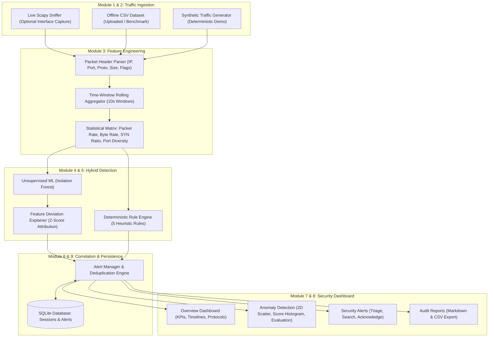

# SentinelNet: Network Traffic Analysis and Anomaly Detection System

A complete, production-grade cybersecurity and computer networks platform for local network traffic monitoring, statistical flow feature extraction, machine learning anomaly detection, and deterministic rule-based threat correlation.

---

## 1. Project Title & Abstract

### Title
**SentinelNet: Network Traffic Analysis and Anomaly Detection System**

### Abstract
Modern computer networks are subject to increasingly complex and rapid cybersecurity threats, including reconnaissance port scans, distributed denial-of-service (DoS) floods, and brute-force connection attempts. Traditional network intrusion detection systems (NIDS) often rely solely on static signatures, leaving zero-day anomalies and stealthy deviations unnoticed. 

**SentinelNet** implements a defensive hybrid intrusion detection architecture combining **unsupervised machine learning (Isolation Forest)** with **transparent, deterministic cybersecurity heuristics**. Built using Python, Scapy, Scikit-learn, Pandas, SQLite, and Streamlit, SentinelNet ingests network traffic via live packet sniffing or offline CSV logs, computes packet-level and time-window flow features, identifies anomalous deviations, correlates alerts, and presents real-time threat intelligence through a dark security-themed interactive dashboard. The platform features an offline **Synthetic Demonstration Mode** designed specifically for university demonstrations, academic vivas, and local testing without requiring elevated permissions or external network dependencies.

---

## 2. Problem Statement

Network administrators and security analysts face significant challenges:
1. **Volumetric & Behavioral Variety:** Traditional firewalls easily miss reconnaissance sweeps and low-and-slow connection attempts that don't match static signatures.
2. **Alert Fatigue:** Naive anomaly detection algorithms flood security analysts with thousands of raw packet-level alerts rather than consolidated, actionable incidents.
3. **Privacy Concerns:** Capturing full packet payloads poses serious privacy, compliance, and legal concerns.
4. **Environment Constraints:** In university environments or Windows laptops, installing raw packet capture drivers (e.g., Npcap) or running as an elevated Administrator is often restricted.

SentinelNet solves these challenges by providing a **privacy-preserving metadata analysis architecture** (zero payload collection), **intelligent alert deduplication and correlation**, and an **offline synthetic testbed** alongside live capture capabilities.

---

## 3. Project Objectives

- **Packet Capture & Ingestion:** Safely sniff network packets using Scapy or ingest standard network CSV datasets, extracting IP addresses, ports, protocol identifiers, packet lengths, and TCP flags.
- **Statistical Feature Engineering:** Transform individual packet headers into meaningful flow statistics and rolling time-window aggregations (packet rates, byte rates, SYN ratios, unique destination port/IP counts).
- **Unsupervised Anomaly Detection:** Implement Scikit-learn's Isolation Forest algorithm to score and isolate statistical deviations without requiring prior ground-truth labels.
- **Deterministic Heuristic Engine:** Implement transparent, configurable cybersecurity rules targeting port scans, volumetric traffic spikes, TCP SYN floods, and brute-force attempts.
- **Hybrid Alert Correlation:** Correlate ML anomaly scores with rule violations to elevate high-confidence incidents into "Hybrid" alerts with prioritized severity.
- **Persistent Incident Triage:** Store sessions and alerts in an embedded SQLite database, supporting searching, severity filtering, triage acknowledgment, and CSV/Markdown export.
- **Interactive Security Dashboard:** Deliver an intuitive, responsive Streamlit dashboard with Plotly charts.

---

## 4. Main Features

- 🛡️ **Hybrid Intrusion Detection:** Unsupervised Isolation Forest + Deterministic Rule Engine + Hybrid Correlation.
- 📡 **Optional Live Packet Capture:** Scapy-based background sniffer with duration and packet count safeguards.
- 📁 **CSV Dataset Ingestion:** Flexible column mapping engine supporting standard IDS log schemas (e.g., `saddr`, `source_ip`, `length`, `proto`).
- ⚡ **1-Click Synthetic Demonstration Mode:** Deterministic, reproducible simulation of normal browsing interleaved with 4 cyber attack patterns.
- 🎯 **Feature Attribution (Why was it flagged?):** Calculates feature Z-score deviations against baseline to explain the root cause of flagged anomalies.
- 📊 **Interactive Plotly Visualizations:** Traffic volume timelines, protocol donuts, packet size histograms, 2D outlier scatter plots, and confusion matrices.
- 💾 **SQLite Persistence:** Zero-configuration local database with parameterized queries and index optimization.
- 📝 **Automated Audit Reporting:** One-click generation and download of security audit reports in Markdown (`.md`) and metrics CSV.

---

## 5. System Architecture



---

## 6. Technology Stack

| Layer | Component | Version | Purpose |
|---|---|---|---|
| **Language** | Python | 3.10+ / 3.12 | Core programming runtime |
| **Sniffing** | Scapy | 2.5+ / 2.8.0 | Packet capture, protocol decoding, header extraction |
| **Data Processing** | Pandas, NumPy | Latest stable | Data manipulation, rolling aggregations, array math |
| **Machine Learning**| Scikit-learn | Latest stable | Isolation Forest, Standard Scaler, Evaluation metrics |
| **Storage** | SQLite3 | Built-in | Parameterized relational storage for sessions and alerts |
| **Frontend UI** | Streamlit | 1.30+ / 1.66 | Interactive responsive multi-page web application |
| **Visualizations** | Plotly Express | 5.18+ / 7.1 | Interactive charts, timelines, histograms, and scatter plots |
| **Configuration** | PyYAML | 6.0+ | Declarative detection thresholds and system parameters |
| **Testing** | Pytest | 7.4+ / 9.1 | Automated unit and integration test suite |

---

## 7. Major Modules Explanation

### 1. Packet Capture (`src/capture.py`)
Runs an asynchronous background thread using Scapy's `sniff()` function. It decodes IPv4, TCP, UDP, ICMP, and DNS headers into timestamped dictionaries. It enforces capture duration and maximum packet limits, preventing memory exhaustion. Most importantly, it **never collects packet payloads**, preserving data privacy.

### 2. Dataset Loader & Validator (`src/dataset_loader.py`)
Provides offline file ingestion. It features a schema aliasing engine that automatically maps diverse column names (e.g., `saddr`, `source_ip`, `Source IP`) into canonical internal identifiers. It performs rigorous data hygiene checks, handling missing values, type coercions, and empty files.

### 3. Feature Extraction (`src/feature_extraction.py`)
Bridges packet-level metadata with flow-level dynamics. Packets from the same source IP are aggregated across sliding time windows (default: 10 seconds). Extracted statistical metrics include:
- `packet_rate`: Packets transmitted per second in window.
- `byte_rate`: Bytes transferred per second.
- `syn_ratio`: Ratio of TCP SYN packets to total packets.
- `unique_dst_ports`: Number of distinct target ports (identifies port sweeps).
- `unique_dst_ips`: Number of distinct destination IPs (identifies horizontal scanning).
- `same_dest_attempts`: Repetitive requests to the same destination host:port.

### 4. Machine Learning Anomaly Detector (`src/anomaly_detector.py`)
Implements unsupervised **Isolation Forest**. Instead of modeling "normal" profile boundaries (which is prone to overfitting in noisy network traffic), Isolation Forest recursively partitions feature space. Anomalies are isolated in fewer splits, resulting in shorter path lengths in the decision trees. The module normalizes raw decision scores into a clean `0.0` to `1.0` scale and computes Z-score feature deviations to explain why each specific record was flagged.

### 5. Rule-Based Detection Engine (`src/rule_engine.py`)
Applies transparent cybersecurity heuristics configured in `config.yaml`:
1. **Port Scanning:** Triggered when a source accesses $\ge 10$ unique ports in a 10s window.
2. **Volumetric Traffic Spike:** Triggered when packet rate $\ge 40$ pkts/sec or byte rate $\ge 50,000$ B/sec.
3. **TCP SYN Flood:** Triggered when $\ge 15$ SYN packets are observed and SYN ratio $\ge 70\%$.
4. **Repeated Connection Attempts:** Triggered when $\ge 20$ repeated attempts target the same host:port.
5. **Unusual Destination Sweep:** Triggered when a host initiates contact with $\ge 15$ distinct destination IPs.

### 6. Alert Manager & Correlation (`src/alert_manager.py`)
Performs deduplication within time windows and correlates rule alerts with high ML anomaly scores. If an event triggers both a deterministic rule and a high Isolation Forest score, it is promoted to **Hybrid Detection** with elevated severity (Critical/High).

### 7. Database Persistence (`src/database.py`)
Thread-safe SQLite manager creating `analysis_sessions`, `security_alerts`, and `analysis_summaries` tables. Utilizes parameterized SQL queries to prevent injection and implements table index optimization for sub-millisecond filtering.

### 8. Synthetic Traffic Generator (`src/synthetic_data.py`)
Deterministic, reproducible traffic simulator that creates realistic packet streams combining normal web browsing (HTTP/HTTPS), DNS queries, and background traffic with 4 simulated attack vectors.

### 9. Reporting Module (`src/reporting.py`)
Aggregates session analytics into executive audit summaries, threat rankings, and exportable Markdown (`.md`) and CSV files.

---

## 8. Project Directory Structure

```text
network-anomaly-detection/
│
├── app.py                     # Main Streamlit application entrypoint
├── requirements.txt           # Python dependency specifications
├── README.md                  # Comprehensive documentation and viva guide
├── .gitignore                 # Standard Python/IDE ignore definitions
├── config.yaml                # Detection thresholds & application settings
│
├── .vscode/
│   └── settings.json          # VS Code Python and pytest configurations
│
├── src/
│   ├── __init__.py            # Package initialization
│   ├── capture.py             # Scapy live packet capture manager
│   ├── feature_extraction.py  # Packet-level & time-window statistical aggregator
│   ├── dataset_loader.py      # CSV ingestion & schema validation
│   ├── preprocessing.py       # Feature scaling, encoding & leakage prevention
│   ├── anomaly_detector.py    # Isolation Forest ML pipeline & evaluation
│   ├── rule_engine.py         # Deterministic cybersecurity rule heuristics
│   ├── alert_manager.py       # Alert correlation, deduplication & triage
│   ├── database.py            # SQLite database manager & queries
│   ├── synthetic_data.py      # Deterministic synthetic traffic generator
│   ├── reporting.py           # Markdown & CSV audit report generator
│   └── utils.py               # Shared helpers, styling CSS & pipeline runner
│
├── pages/
│   ├── 1_Overview.py          # Executive KPIs, timelines & protocol donuts
│   ├── 2_Live_Monitoring.py   # Scapy sniffer controls & interface diagnostics
│   ├── 3_Dataset_Analysis.py  # CSV upload, validation & benchmark loader
│   ├── 4_Anomaly_Detection.py # ML score distributions, 2D scatter & confusion matrix
│   ├── 5_Security_Alerts.py   # Alert triage, search, acknowledgment & export
│   └── 6_Reports.py           # Formal audit document & threat intelligence charts
│
├── tests/
│   ├── __init__.py            # Test package initialization
│   ├── test_dataset_loader.py # CSV loading, alias mapping & validation tests
│   ├── test_feature_extraction.py # Window and rate calculation tests
│   ├── test_anomaly_detector.py   # Isolation Forest fit/predict & metric tests
│   ├── test_rule_engine.py    # Heuristic rule detection & deduplication tests
│   └── test_database.py       # SQLite persistence, queries & reset tests
│
├── data/
│   ├── README.md              # Documentation of stored datasets
│   ├── sample_traffic.csv     # Pre-generated synthetic benchmark dataset
│   └── .gitkeep
│
└── reports/
    └── .gitkeep               # Directory for exported audit reports
```

---

## 9. Installation Instructions for Windows

### Prerequisites
- Python 3.10, 3.11, or 3.12 installed on Windows.
- Ensure **"Add python.exe to PATH"** was checked during Python installation.
- (Optional for live capture): [Npcap](https://npcap.com/#download) with "Install Npcap in WinPcap API-compatible Mode" checked. *Note: Npcap is completely optional; synthetic and CSV modes work 100% out-of-the-box without it.*

---

## 10. Opening the Project in VS Code

1. Launch **Visual Studio Code**.
2. Go to **File** ➜ **Open Folder...**
3. Browse to and select:
   ```text
   C:\Users\Prayansh\.gemini\antigravity\scratch\network-anomaly-detection
   ```
4. VS Code will load the project with pre-configured settings in `.vscode/settings.json`.

---

## 11. Creating and Activating a Virtual Environment

Open a new PowerShell terminal inside VS Code (`Ctrl + ` `~`):

```powershell
# Navigate to project root
cd C:\Users\Prayansh\.gemini\antigravity\scratch\network-anomaly-detection

# Create a virtual environment named 'venv'
python -m venv venv

# Activate the virtual environment in PowerShell
.\venv\Scripts\Activate.ps1
```

*(If PowerShell displays an `Execution_Policies` restriction, run `Set-ExecutionPolicy -Scope Process -ExecutionPolicy Bypass` and reactivate).*

---

## 12. Dependency Installation

Install all required packages from `requirements.txt`:

```powershell
pip install -r requirements.txt
```

Verify that all dependencies are installed:
```powershell
python -c "import streamlit, scapy, sklearn, pandas, numpy, plotly, yaml, pytest; print('All dependencies successfully installed!')"
```

---

## 13. Instructions for Launching the Application

Run the Streamlit application from the project root:

```powershell
streamlit run app.py
```

Streamlit will launch local server at:
```text
  Local URL: http://localhost:8501
  Network URL: http://192.168.x.x:8501
```
Open `http://localhost:8501` in your web browser.

---

## 14. Instructions for Using Synthetic Demonstration Mode

SentinelNet's Synthetic Demonstration Mode allows you to demonstrate every feature of the project offline:

1. Open the application at `http://localhost:8501`.
2. On the **Main Dashboard (Home Page)**, locate the **Quick Start** card.
3. Click the red button: **"🔥 Run Complete Synthetic Demo"**.
4. SentinelNet will generate 1,120 realistic network packets containing:
   - Normal HTTP/HTTPS web browsing.
   - Normal UDP DNS queries.
   - An external SYN Port Scan from `203.0.113.88`.
   - A volumetric DoS Traffic Spike from `198.51.100.42`.
   - A TCP SYN Flood from `203.0.113.199`.
   - A repeated brute-force connection attempt from `192.168.1.45`.
5. Navigate through the sidebar:
   - **1_Overview:** View KPIs, attack timelines, and protocol distributions.
   - **4_Anomaly_Detection:** Explore Isolation Forest anomaly scores, 2D outlier scatter plot, and ground-truth confusion matrix.
   - **5_Security_Alerts:** Review generated alerts, inspect defensive recommendations, and click **"✔️ Acknowledge"**.
   - **6_Reports:** Review and download the generated audit report.

---

## 15. Instructions for Uploading a CSV Dataset

1. In the sidebar, select **3_Dataset_Analysis**.
2. Under **Upload Network CSV Dataset**, drag and drop your `.csv` file.
3. SentinelNet will automatically validate the columns and map aliases:
   - Required columns: Source IP, Destination IP, Source Port, Destination Port, Protocol, Packet Size.
4. Preview the validated data table.
5. Adjust the **ML Sensitivity (Contamination)** slider if desired.
6. Click **"🚀 Run Full Security Analysis Pipeline"**.

---

## 16. Instructions for Running Live Packet Capture

1. In the sidebar, select **2_Live_Monitoring**.
2. Select your active network adapter from the **Network Interface** dropdown.
3. Set your desired **Duration** (e.g. 15 seconds) and **Max Packet Limit** (e.g. 500 packets).
4. Optionally enter a BPF filter (e.g. `tcp or udp`).
5. Click **"▶️ Start Live Capture"**.
6. Packets will appear in real time in the table below.
7. Click **"⚡ Run Anomaly Detection Pipeline on Captured Data"** to analyze your live network traffic!

---

## 17. Permissions & Platform Considerations

- **Windows Packet Sniffing:** Raw network socket sniffing on Windows requires either:
  1. Running the terminal / VS Code as **Administrator**, OR
  2. Installing [Npcap](https://npcap.com/#download) with WinPcap API-compatible mode enabled.
- **Graceful Fallback:** If Npcap or administrator privileges are missing, SentinelNet will **not crash**. It will display a clear diagnostic notice and provide immediate fallback to **Synthetic Demo Mode** or **CSV Dataset Ingestion**.

---

## 18. Testing Instructions

SentinelNet includes an automated Pytest test suite covering data loading, feature engineering, ML anomaly detection, rule heuristics, and database persistence.

To execute the automated test suite:

```powershell
python -m pytest -v
```

Expected output:
```text
tests/test_anomaly_detector.py::test_isolation_forest_fit_predict PASSED
tests/test_anomaly_detector.py::test_model_evaluation_metrics PASSED
tests/test_anomaly_detector.py::test_tiny_dataset_handling PASSED
tests/test_database.py::test_session_creation PASSED
tests/test_database.py::test_alert_persistence_and_acknowledgment PASSED
tests/test_database.py::test_reset_demo_data PASSED
tests/test_dataset_loader.py::test_synthetic_data_loading PASSED
tests/test_dataset_loader.py::test_column_alias_mapping PASSED
tests/test_dataset_loader.py::test_missing_required_columns PASSED
tests/test_dataset_loader.py::test_empty_csv PASSED
tests/test_feature_extraction.py::test_packet_feature_extraction PASSED
tests/test_feature_extraction.py::test_window_feature_extraction PASSED
tests/test_feature_extraction.py::test_empty_dataframe_feature_extraction PASSED
tests/test_rule_engine.py::test_port_scan_detection PASSED
tests/test_rule_engine.py::test_traffic_spike_detection PASSED
tests/test_rule_engine.py::test_syn_flood_detection PASSED
tests/test_rule_engine.py::test_alert_deduplication PASSED

============================= 17 passed in 2.29s =============================
```

---

## 19. Troubleshooting Common Errors

### Q: `PermissionError: [WinError 10013]` during live packet capture
**Cause:** Raw socket capture requires Windows Administrator rights or Npcap.  
**Solution:** Right-click VS Code / Terminal and select "Run as Administrator", install Npcap, or use **Synthetic Demo Mode** / **CSV Analysis**.

### Q: `ModuleNotFoundError: No module named 'src'`
**Cause:** Python is running without the project root in its path.  
**Solution:** Ensure you run commands from the project root directory (`C:\Users\Prayansh\.gemini\antigravity\scratch\network-anomaly-detection`). `app.py` automatically injects `ROOT_DIR` into `sys.path`.

### Q: Streamlit port conflict (`Port 8501 is already in use`)
**Solution:** Specify a different port:
```powershell
streamlit run app.py --server.port 8502
```

---

## 20. Machine Learning vs. Rule Engine: Academic Comparison

| Dimension | Isolation Forest (Machine Learning) | Rule-Based Engine (Heuristics) |
|---|---|---|
| **Underlying Principle** | Unsupervised partition tree ensemble. Identifies points that are few and different. | Fixed deterministic conditional thresholds (e.g. `unique_ports >= 10`). |
| **Zero-Day Detection** | High. Catches novel traffic patterns and unusual statistical combinations. | Low. Can only catch known patterns explicitly defined in rules. |
| **Interpretability** | Moderate (requires Z-score feature deviation analysis). | High. Exactly explains which threshold was violated. |
| **False Positive Rate** | Dependent on contamination tuning and dataset variance. | Minimal when thresholds are calibrated properly. |
| **Computational Cost** | $O(n \log n)$ tree construction and prediction. | $O(n)$ linear evaluation over window records. |
| **Role in SentinelNet** | Scores overall outlier degree ($0.0 - 1.0$) across all features. | Catches known attack signatures (Port scans, SYN floods, Spikes). |
| **Hybrid Synergy** | When both flag an event, it is elevated to **Hybrid (Critical/High)** priority. |

---

## 21. Viva & Project Defense Guide (Common Questions & Answers)

### Q1: Why did you choose Isolation Forest over K-Means or Autoencoders?
> *"Isolation Forest is specifically designed for anomaly detection rather than clustering. Clustering algorithms like K-Means model the dense normal regions, which is computationally expensive ($O(n^2)$) and susceptible to noise. Isolation Forest isolates anomalies directly using binary trees because anomalies are few and have distinct attribute values, requiring fewer splits. It also scales in $O(n \log n)$ time, making it suitable for high-volume network streams."*

### Q2: Why aggregate packets into time windows rather than analyzing each packet independently?
> *"Single packet headers rarely indicate attacks. For example, a single TCP SYN packet is a normal part of the standard three-way handshake. A SYN flood or port scan only becomes apparent when observing the collective rate, SYN-to-ACK ratio, and number of targeted ports across a temporal window (e.g. 10 seconds). Time-window aggregation captures contextual flow dynamics."*

### Q3: How do you prevent data leakage in your ML pipeline?
> *"All identifier fields (IP addresses, timestamps, ports) and ground-truth validation labels (`is_anomaly`, `attack_type`) are explicitly excluded from feature matrices in `src/preprocessing.py`. The model is trained purely on statistical behavior (rates, sizes, flag ratios)."*

### Q4: Why is payload inspection avoided?
> *"Payload inspection (Deep Packet Inspection or DPI) raises severe user privacy concerns, violates confidentiality, and fails on modern encrypted traffic (HTTPS/TLS 1.3). Metadata analysis based on packet sizes, timing, and flow statistics is privacy-preserving and works effectively even with encrypted payloads."*

---

## 22. Limitations & Future Enhancements

- **Current Limitations:**
  - Designed for IPv4 network metadata (IPv6 supported at header level, but rules target IPv4).
  - Unsupervised models require threshold tuning in environments with bursty application traffic.
- **Future Enhancements:**
  - Automated dynamic threshold baseline updating using online incremental learning.
  - Integration with Snort / Suricata rules format.
  - PCAP file export and replay functionality.
